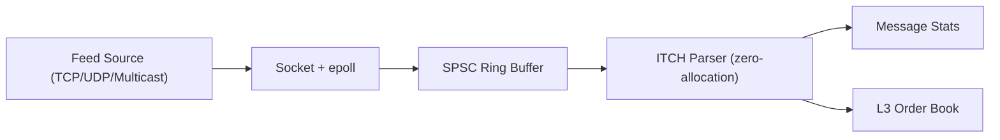

# ApexFeed

ApexFeed is a low-latency C++ market data ingest stack for ITCH-style feeds.

## Key Upgrades

- Zero-allocation ITCH parser hot path (`const uint8_t*` input, fixed-size `Field` output)
- Safe TCP message boundary reconstruction for fragmented/coalesced streams
- Non-blocking socket abstraction with EINTR/EAGAIN handling
- TCP, UDP, and UDP multicast socket modes
- Epoll-based ingest loop for multi-connection feeds
- Single-producer single-consumer lock-free ring buffer (`Socket -> Parser`)
- L3 order book reconstruction (`Add/Execute/Cancel/Delete/Replace`)
- Throughput + parser-latency stats (`msg/sec`, `avg_parse_ns`, message counts by type)
- Feed replay and cycle-level parser benchmark (`rdtsc`)

## Architecture



## Project Layout

- `Parser/` ITCH parser and message field definitions
- `Socket/` socket abstraction and transport setup
- `OrderBook/` in-memory L3 book builder
- `Core/` lock-free queue and metrics utilities
- `Benchmarks/` replay tool and latency benchmark
- `Benchmarks/results/` generated perf reports (`make perf`)
- `Test/` sender/receiver integration test programs
- `feed_ingest.cpp` epoll + ring-buffer ingest executable
- `main.cpp` simple ingest receiver

## Build

```bash
cmake -S . -B build -DCMAKE_BUILD_TYPE=Release
cmake --build build -j
```

## Make Workflows

```bash
make help
make build
make smoke COUNT=200000
make ingest-smoke COUNT=120000 REPORT=50000
make latency
make perf
make perf PERF_SMOKE_COUNT=250000 PERF_INGEST_COUNT=150000 PERF_LAT_ITERS=3000000
make replay REPLAY_FILE=data/itch_sample.bin REPORT=100000
make run-receiver
make run-sender COUNT=400000
make run-ingest REPORT=100000
```

`make perf` writes a single timestamped report to `Benchmarks/results/perf_*.txt` and updates `Benchmarks/results/latest.txt`.

## Run

### High-throughput receiver test

```bash
./build/test_feed_receiver
```

In another terminal:

```bash
./build/test_feed_sender --count=400000
```

### Epoll ingest loop

```bash
./build/feed_ingest --mode=tcp --ip=0.0.0.0 --port=9001 --report=100000
```

### Multicast ingest mode

```bash
./build/feed_ingest --mode=multicast --ip=239.1.1.1 --port=5000 --iface=0.0.0.0
```

### Replay captured feed file

```bash
./build/replay_feed data/itch_sample.bin --chunk=65536
```

### Parser latency benchmark

```bash
./build/latency_bench 5000000
```

## Performance Notes

Expected local performance on a modern desktop CPU (Release build):

- `>100k msg/sec` is realistic with TCP test feed
- Parser path should sustain significantly above that under replay/bench modes
- `latency_bench` reports cycles/message and ns/message for parser-only cost
