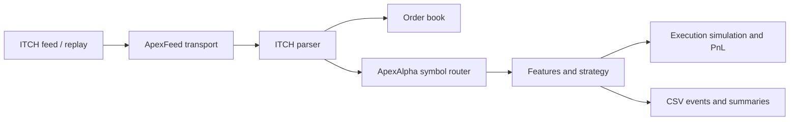

# ApexFeed + ApexAlpha

ApexFeed + ApexAlpha is a C++20 market-data research stack for ITCH-style feeds. **ApexFeed** handles transport, parsing, and order-book construction; **ApexAlpha** consumes decoded market events to build features, route symbols, evaluate a strategy, simulate executions, and report results.

The project targets Linux and POSIX sockets. It uses CMake and has no external C++ library dependencies.

## Components

### ApexFeed

- TCP, UDP, and multicast socket support
- ITCH message parsing and TCP stream boundary handling
- Epoll-based ingestion and an SPSC ring-buffer pipeline
- L3 order-book reconstruction
- Feed replay, message statistics, and parser latency benchmarks

### ApexAlpha

- Multi-symbol event routing
- Market features including spread, mid-price, microprice, queue imbalance, and order-flow imbalance
- Threshold strategy evaluation
- Top-of-book execution simulation and PnL tracking
- CSV event output and per-symbol/global summaries



## Repository Layout

- `ApexFeed/` C++ ingest engine, parser, socket layer, order book, benchmarks, and CMake project
- `ApexAlpha/` feature, routing, strategy, simulation, and replay application code
- `Test/` ApexAlpha test runners, synthetic feed generator, test configurations, and performance reports

See the [ApexFeed component guide](ApexFeed/README.md), [test workspace guide](Test/README.md), and [detailed performance report](Test/PERFORMANCE_REPORT.md).

## Requirements

- Linux
- C++20 compiler (GCC or Clang)
- CMake 3.16 or newer
- Make
- Python 3 for synthetic feed test generation

## Build

Build from the nested `ApexFeed/` project directory. Its CMake configuration also builds ApexAlpha targets from the sibling `ApexAlpha/` directory.

```bash
cd ApexFeed
cmake -S . -B build-local -DCMAKE_BUILD_TYPE=Release
cmake --build build-local -j
```

Using a fresh build directory avoids conflicts with pre-existing CMake caches that may have been configured from a different source directory.

## Test and Run

### ApexFeed TCP integration smoke

This launches a local TCP receiver and sender, then reports parsed message throughput and order-book totals:

```bash
cd ApexFeed
make BUILD_DIR=build-local smoke COUNT=200000
```

### ApexAlpha stress run

From `Test/`, this generates a synthetic multi-symbol feed, builds the project, runs all three ApexAlpha unit tests, then replays the feed and writes a CSV and summary:

```bash
cd Test
./run_test.sh --stress
```

### ApexAlpha performance run

This generates a larger synthetic feed, runs the unit tests, and performs three replay iterations with timing and memory summaries:

```bash
cd Test
./run_test.sh --perf
```

### Replay a feed file directly

```bash
cd Test
./run_apexalpha_test.sh /path/to/itch_feed.bin [strategy_config.cfg]
```

The direct runner writes a timestamped result directory containing the replay log and event CSV. The stress and performance workflows save their generated feed manifests and run outputs under `Test/StressTesting/` and `Test/PerfTesting/` respectively.

## Recorded Performance Snapshot

These are results from the local synthetic runs documented in the [full performance report](Test/PERFORMANCE_REPORT.md). They are workload-specific measurements, not guaranteed production rates.

| Component / test | Workload | Result |
| --- | --- | --- |
| ApexFeed TCP smoke | 200,000 Add Order messages over loopback TCP | 193,517 msg/sec end-to-end; 140.918 ns average parse time; 200,000 orders applied |
| ApexAlpha stress replay | 576,000 messages, 24 symbols, one replay | 244,194 msg/sec; all 576,000 routed; zero unrouted |
| ApexAlpha repeated replay | 960,000 messages, 32 symbols, three replays | 117,595 msg/sec average; 123,393 msg/sec best; about 39 MB peak RSS |
| ApexFeed parser microbenchmark (historical) | 2,000,000 parser iterations | 29.955 ns/message; 80.516 cycles/message |

ApexAlpha's synthetic performance run emitted 960,000 CSV rows per iteration and reported total simulated PnL of `-239,984,000` PnL units. This is a result of the synthetic input and test strategy configuration; it is **not** a real-market profitability estimate. The ApexFeed parser microbenchmark is from an older stored report and is not the same workload as the TCP smoke test.

## Further Documentation

- [ApexFeed build options and executables](ApexFeed/README.md)
- [ApexAlpha test workflows](Test/README.md)
- [Performance methodology, per-run results, and limitations](Test/PERFORMANCE_REPORT.md)
